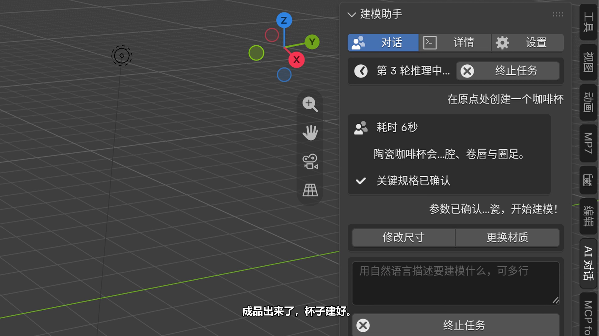
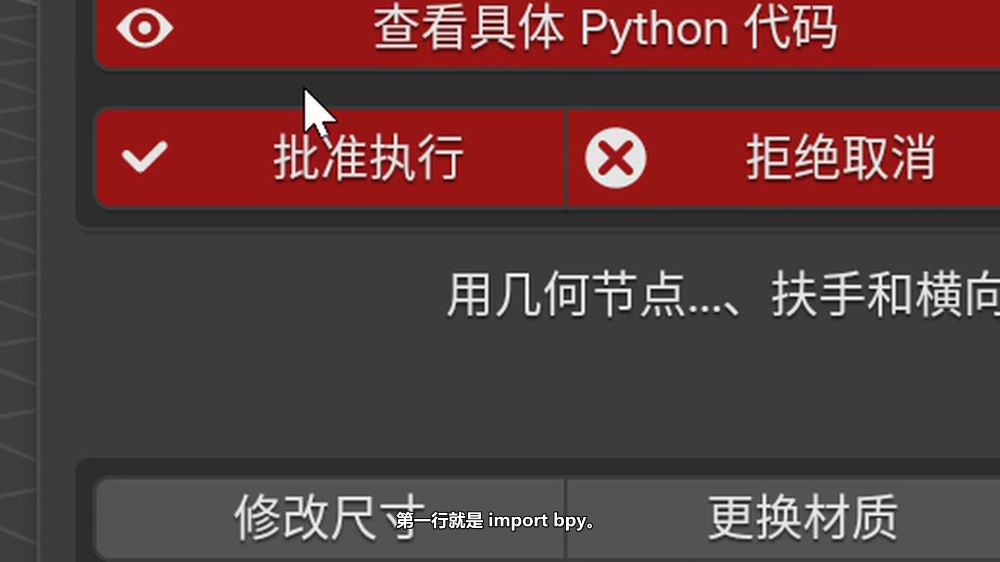
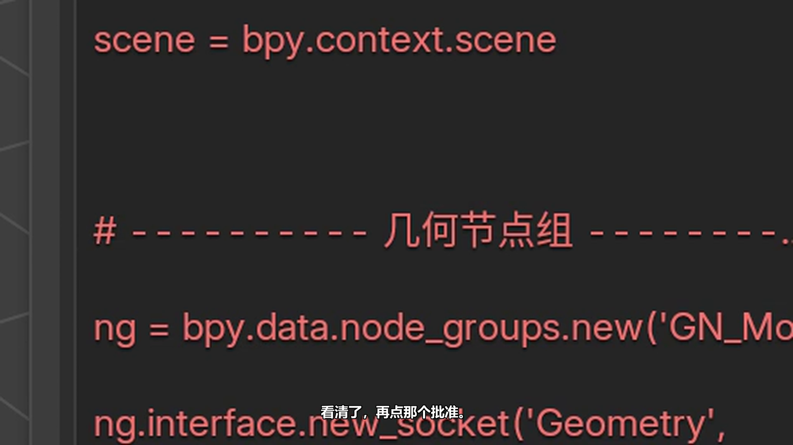

# Blender Agent

> 用自然语言驱动 Blender 的 AI 扩展。
> 在 Blender 里说一句「在原点做一个咖啡杯」，它会调 Blender 的 API 把模型建出来；
> **动你的场景之前一定先弹审批，生成的 Python 代码你能展开逐行看。**

Blender 5.2 扩展 · v0.5.0 · MIT 协议 · 支持 DeepSeek / MiniMax



<p align="center">
  
</p>

> 宣传片《怪盗预告函》：2 分 37 秒，32 个镜头，六个真实案例一帧没剪。
> 在 B 站 / 小红书搜索「Blender Agent 怪盗预告函」。

---

## 目录

- [这是什么](#这是什么)
- [安装](#安装)
- [配置 AI 服务商](#配置-ai-服务商)
- [五个工具](#五个工具)
- [执行前一定先审批](#执行前一定先审批)
- [能力边界（v0.5.0 实测）](#能力边界v050-实测)
- [隐私与安全](#隐私与安全)
- [已知限制](#已知限制)
- [开发](#开发)
- [许可证](#许可证)

---

## 这是什么

Blender Agent 是一个装在 Blender 里的 AI 助手。它把自然语言翻译成对 Blender 场景的实际操作：

| 你说 | 它做 |
|---|---|
| 「在原点做一个咖啡杯」 | 调 `create_primitive` 建体块，再 `set_material` 上材质 |
| 「在 3D 游标处创建一台坦克」 | 先反问你要什么型号，拿到参数再动手 |
| 「把这个杯子放大一倍」 | `transform_object` 改缩放 |
| 「换成哑光陶瓷」 | `set_material` 换材质 |
| 「用几何节点搭一座山体」 | `execute_blender_code` 写几何节点树 |

**连续迭代是它的核心**：上一轮的结果就是下一轮的上下文。你可以接着说「再改成 1.5 倍」，
它知道「它」指的是哪个物体。

<p align="center">
  
</p>

---

## 安装

### 方式一：下载 zip 安装（推荐）

1. 从 [Releases](https://github.com/nKwYi/Blender-Agent/releases) 下载
   `blender_deepseek_agent-0.5.0.zip`
2. Blender → **编辑 → 偏好设置 → 插件** → 右上角下拉 → **从磁盘安装** → 选这个 zip
3. 勾选启用 **Blender Agent**

命令行等价写法：

```bash
blender --command extension install-file -r user_default -e blender_deepseek_agent-0.5.0.zip
```

### 方式二：从源码装

```bash
git clone https://github.com/nKwYi/Blender-Agent.git
blender --command extension install-file -r user_default -e Blender-Agent/blender_deepseek_agent
```

> 源码目录里是 `blender_deepseek_agent/`（**不是** `blender_agent/`）——
> 扩展 id 一旦发布就不能改了，否则用户的插件配置和场景里的数据都会丢。

### 环境要求

- Blender **5.2** 或更高
- 一个可用的 AI 服务商 API Key（DeepSeek 或 MiniMax）

---

## 配置 AI 服务商

**编辑 → 偏好设置 → 插件 → Blender Agent → 设置**

| 配置项 | 说明 |
|---|---|
| 服务商 | DeepSeek / MiniMax，切换后自动换 base_url 和默认模型 |
| API Key | 可以填在这里（存在本机 `userpref.blend`），也可以留空改用环境变量 |
| 模型 | 可以手填，也可以点「获取最新模型列表」从服务商拉 |

### 用环境变量放 Key（推荐）

不想让 Key 落在磁盘上，就留空设置框，改用环境变量：

```bash
# DeepSeek
export DEEPSEEK_API_KEY=sk-...
# MiniMax（Token Plan）
export MINIMAX_API_KEY=sk-cp-...
```

### 可用模型

| 服务商 | 预置模型 |
|---|---|
| DeepSeek | `deepseek-flash`、`deepseek-chat`、`deepseek-reasoner` |
| MiniMax | `MiniMax-M3.1-Flash`、`MiniMax-M3`、`MiniMax-M2.7`、`MiniMax-M2.5` |

两个服务商都是 OpenAI 兼容接口，所以换服务商不需要换插件。

---

## 五个工具

插件对外只暴露 5 个工具，边界是清楚的：

| 工具 | 作用 |
|---|---|
| `get_scene_info` | 读当前场景：物体列表、名称、类型、变换、材质 |
| `create_primitive` | 建基础体块（cube / sphere / cylinder / cone / plane） |
| `set_material` | 给物体设置基础材质（Principled BSDF 参数） |
| `transform_object` | 改位置 / 旋转 / 缩放 / 尺寸 |
| `execute_blender_code` | 在 Blender 的 Python 作用域里执行任意代码 |

最后那个是「万能」的 —— 几何节点、复杂建模、批量操作都靠它。
所以它**必须走审批**（见下一节）。

---

## 执行前一定先审批

<p align="center">
  
</p>

模型要执行 `execute_blender_code` 时，面板会弹出审批框：

- **查看具体 Python 代码** —— 展开就能看到它准备跑的完整代码
- **批准执行** / **拒绝取消**

审批是**逐次**的，不是「一次批准后面全放行」。
你可以只批准其中一次，也可以连续拒绝。

<p align="center">
  
</p>

上图是它自己写的几何节点代码 —— 节点树是真搭出来的，不是贴图。

其它已实现的行为：

- **反问**：信息不够时它会反问（杯型？坦克型号？），并把选项列出来让你点
- **超时自停**：请求超时自动停，不会一直挂着
- **出错可回退**：上一轮操作可以撤销
- **完整记录**：每次工具调用、用量、耗时都有记录，可导出

---

## 能力边界（v0.5.0 实测）

下面这些是**真跑出来的**结果，不是设想：

| 案例 | 结果 |
|---|---|
| 原点建咖啡杯 | 建成，4 个物体 |
| 游标处建坦克 | 建成，10 个物体，11,837 顶点 |
| 编辑已有模型（放大 + 换材质） | 建成，6 个物体 |
| 几何节点围栏 | 建成，5 个物体 |
| 几何节点山体 | 建成，5 个物体，56,452 顶点 |
| 紫砂茶壶（追加修改） | 建成，8 个物体 |

**做不到的**（别当它能）：

- ❌ 识别任意已有几何体 / 自动导入外部资产
- ❌ 材质库检索、贴图下载
- ❌ 动画、 rigging、渲染出图
- ❌ 记住上一次会话（上下文只在当前任务内）

---

## 隐私与安全

- **API Key 不会写进场景文件**（`.blend` 里没有它）
- 但如果你在设置框里填了 Key，它是**明文存进 Blender 的偏好设置文件**
  （`userpref.blend`，只在你本机）。**想完全不落盘就用环境变量**：

  ```bash
  export DEEPSEEK_API_KEY=sk-...      # DeepSeek
  export MINIMAX_API_KEY=sk-cp-...     # MiniMax Token Plan
  ```

- 日志、错误详情、导出的转录里出现的 Key 会被**自动脱敏**（替换成 `sk-***`）
- **不要把 Key 提交进仓库** —— 本仓库的 `.gitignore` 已经挡住了 `.env` / `*.key` / `*.pem` / `userpref.blend`
- 插件会把你说的话**发给所选的 AI 服务商**（DeepSeek 或 MiniMax）—— 这跟任何 AI 服务一样，
  请自行判断你的场景数据是否适合发出去
- `execute_blender_code` 能跑任意 Python，**权限边界完全依赖你点「批准执行」**

发现安全问题请开 issue，或见 [SECURITY.md](SECURITY.md)。

---

## 已知限制

- 扩展 id 仍叫 `blender_deepseek_agent`（历史原因，改 id 会丢用户配置），但**显示名是 Blender Agent**
- 依赖 `mathutils` 的代码在某些无头环境下会被拒绝执行
- 首次点「获取最新模型列表」需要服务商网络可达
- 界面里的「详情」页有四个分组尚未画出来

---

## 开发

```bash
git clone https://github.com/nKwYi/Blender-Agent.git
cd Blender-Agent
```

### 跑回归测试

```bash
powershell -ExecutionPolicy Bypass -File dev/run_all.ps1 -SkipGen
```

当前基线：**PASS 14 / FAIL 1**。那 1 个是 `test_proposal_blocks` 的既有问题
（`dev/build_blocks.py` 与当前 `ui.py` 脱节），与功能改动无关。

### 代码结构

```
blender_deepseek_agent/     扩展本体（发布的就是这个目录）
  blender_manifest.toml     扩展清单：id / 版本 / 权限声明
  config.py                 服务商配置、Key 读取与脱敏
  agent.py                  与 OpenAI 兼容接口对话、工具调用循环
  tools.py                  5 个工具的实现
  worker.py                 后台线程，防止界面卡住
  state.py                  场景级状态（存在 scene.deepseek_agent）
  receipt.py                工具调用凭据
  ui.py                     面板 UI
dev/                        开发脚本与回归测试
docs/                       文档与截图
```

### 打包

```bash
# zip 是扁平的（blender_manifest.toml 在根目录），这是 Blender 扩展的要求
python -c "import zipfile,pathlib; src=pathlib.Path('blender_deepseek_agent'); \
[zipfile.ZipFile('dist/blender_deepseek_agent-0.5.0.zip','w',zipfile.ZIP_DEFLATED,compresslevel=9).write(p,p.name) \
 for p in sorted(src.iterdir()) if p.is_file() and p.suffix in ('.py','.toml')]"
```

---

## 许可证

[MIT](LICENSE) © 2026 Blender Agent contributors

**免责声明**：本项目按「原样」提供，不对使用后果做任何担保。
生成的几何、材质与代码由模型产出，**请自行检查后再用于生产场景**。
使用者需自行遵守所选 AI 服务商的服务条款。
